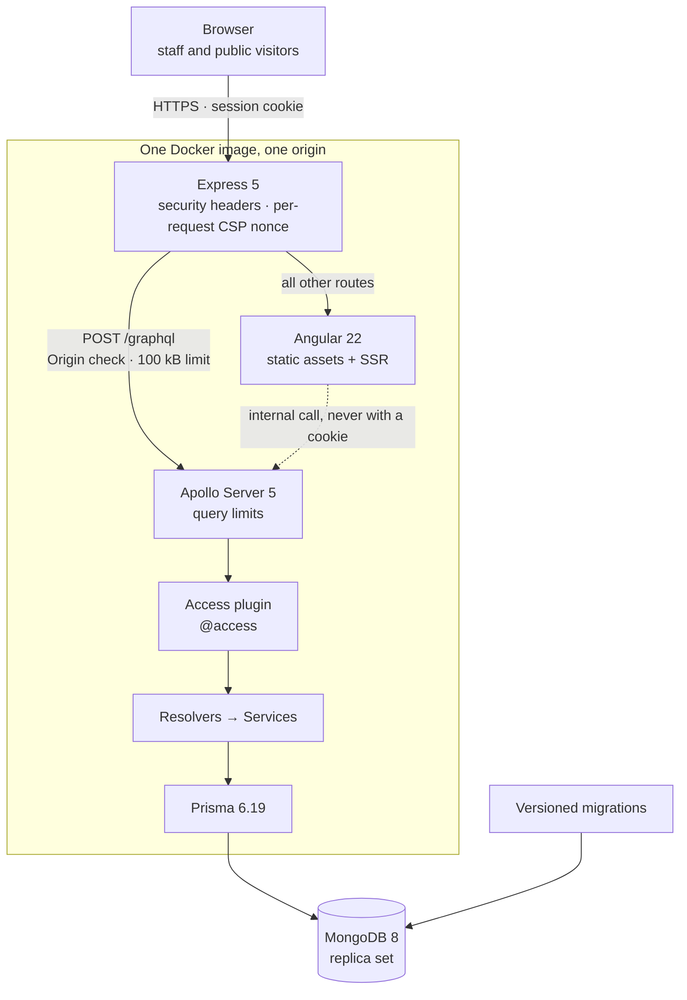
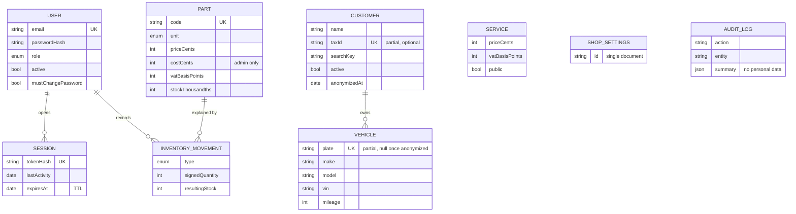
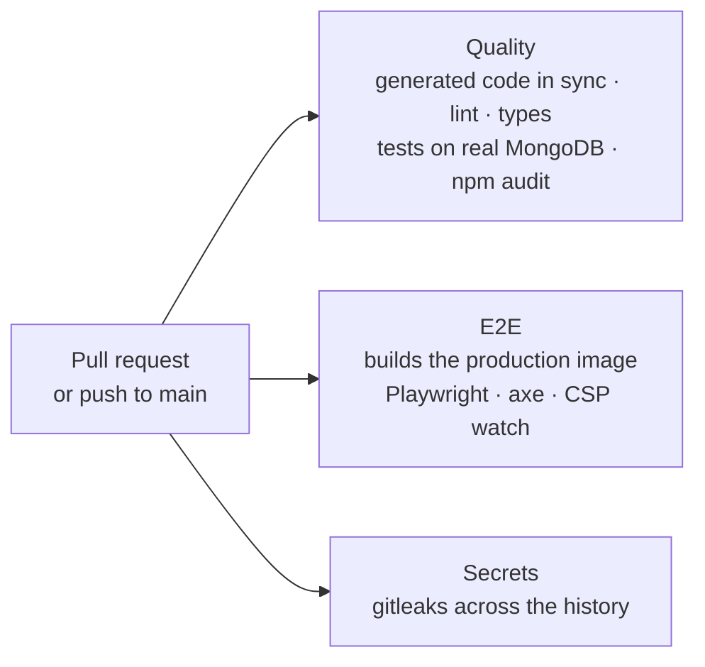

<div align="center">

# Auto Repair Shop Management Platform

### A secure, white-label operations system for independent auto repair shops

**Case study · Private repository · In active development**


</div>

---

| | |
|---|---|
| **Role** | Sole engineer: architecture, full-stack development, DevOps and technical documentation |
| **Domain** | Internal operations software for auto repair shops (customers, vehicles, services, parts inventory, work orders, scheduling) with a public website |
| **Timeline** | Development started in October 2026 · about 50 commits in the first 6 days, covering the foundation and the first business modules |
| **Status** | Foundation merged, Phase 2 of 5 close to done. **Not in production yet**: deployment is a planned phase |

---

## Table of Contents

1. [Executive Summary](#1-executive-summary)
2. [Privacy Notice](#2-privacy-notice)
3. [Product Requirements](#3-product-requirements)
4. [Architecture & Tech Stack](#4-architecture--tech-stack)
5. [Deep Dive: Technical Challenges & Solutions](#5-deep-dive-technical-challenges--solutions)
6. [Key Metrics](#6-key-metrics)
7. [Status, Roadmap & Known Gaps](#7-status-roadmap--known-gaps)
8. [Engineering Practices](#8-engineering-practices)
9. [Skills Demonstrated](#9-skills-demonstrated)

---

## 1. Executive Summary

Independent repair shops need one place for their daily work: customers, vehicles, work orders, parts inventory and appointments. This project is that system: internal software for the staff plus a public website for the shop, built as **a product that any shop can install and that someone else can operate**. So far I have designed and built:

- **A GraphQL API with deny-by-default authorization.** Each of its 37 operations declares an access level. A plugin rejects the whole operation before anything runs, and the build fails if a new operation forgets to declare one.
- **Concurrency-safe business modules** for staff accounts, customers, vehicles, the service catalog and a parts inventory ledger, built on MongoDB transactions with retries, write-skew protection and optimistic checks.
- **A governed schema on a schemaless database.** Versioned migrations create every collection, validator and index, and contract tests keep them identical to the ORM's view of the data.
- **A hardened session layer**: opaque tokens hashed at rest, `HttpOnly` + `SameSite=Strict` cookies, Argon2id, and brute-force protection that holds up under parallel bursts.
- **One deployable image.** Angular 22 with server-side rendering runs inside the API process on a single origin, under a strict Content Security Policy with per-request nonces.
- **A CI pipeline that tests what will ship**: 230 API tests (unit, plus integration against a real MongoDB, at 96.6% line coverage), 32 web tests, and end-to-end tests against the production image that fail on any CSP violation or accessibility finding on the pages they visit.

The guiding principle: **if a rule matters, the schema, the database or a failing test enforces it**. Nothing important depends on someone remembering it.

---

## 2. Privacy Notice

> [!NOTE]
> **The source code is proprietary and lives in a private repository.** The code is the product, and the system is being prepared for sale to repair shops.
>
> This case study is anonymized and written so a reviewer can judge the engineering without that exposure:
>
> - **No shop name, location, customer data, credentials or infrastructure identifiers** appear in this document.
> - Code fragments are **illustrative**, with English names of my choosing. They show the pattern, they are not excerpts from the codebase.
> - All figures are **engineering metrics**, taken from the development branch on October 30, 2026.
> - There are no business or revenue figures because the product has not launched.
>
> I'm happy to walk through the architecture, the design records or selected parts of the code **in a live session**.

---

## 3. Product Requirements

The goal is to sell the system to independent shops, and that sets the bar for every technical decision:

| Requirement | How the design answers it |
|---|---|
| **Secure by default.** It stores customers' personal data, which falls under Ecuador's data-protection law | No public sign-up: only staff have accounts, and only an admin creates them. Each operation declares its access level, and undeclared operations don't run for anyone |
| **Configurable, not custom-built** | Name, contact details, map, opening hours and tax rate come from a settings document, never from the code |
| **Operable by someone who didn't write it** | Versioned migrations create the whole database, the system ships as one Docker image, and CI runs on every pull request against a real, migrated MongoDB replica set |
| **Built around how a shop works** | Vehicles are first-class, and work orders are the next phase. The plate is what staff type at reception, and it leads to the owner |
| **Clear on tax** | The system issues a work order or proforma with no tax value. Electronic invoicing comes in a later phase |

---

## 4. Architecture & Tech Stack

### 4.1 System Overview



**Why one image.** When the web and the API live on different sites, browsers block the session cookie and the app falls back to a token that scripts can read. Serving both from the same origin makes `HttpOnly` + `SameSite=Strict` possible with no CORS configuration at all. It also gives the end-to-end tests the real security headers, because they run against the same image that will be deployed.

**Rendering is split by trust.** Public pages render on the server, for search engines and a fast first paint. The login and the staff panel render only in the browser. The SSR layer calls the API internally and never with a cookie, so it is structurally unable to render private data.

**Installation model.** One instance per shop. There is no `shopId` on every collection: isolation is total, and there is less code to get wrong.

### 4.2 Request Lifecycle

1. **Express** sets the security headers and the nonce. On `/graphql` it checks the `Origin` and caps the body at 100 kB.
2. **Context** reads the cookie and loads the session, enforcing the idle and absolute expirations and re-reading the account's status.
3. **GraphQL validation** applies depth, alias, directive, cost and token limits. A rejection is a clean `400` and nothing executes.
4. **The access plugin** computes the highest level the operation needs, fragments included, and rejects the entire operation if the session falls short.
5. **Resolver → service.** Resolvers stay thin. Each service validates its input with zod and is the only layer that imports Prisma. Multi-document writes run inside a retried transaction.
6. **Errors.** Only business errors and GraphQL's own reach the client, with a stable code and a user-facing message. Anything else is logged and returned as a generic internal error.

Operations get two separate signals: `GET /health` reports that the process is alive without touching the database, and `GET /ready` pings MongoDB and returns `503` when it can't reach it.

### 4.3 Tech Stack

| Layer | Technologies | Why |
|---|---|---|
| **Frontend** | Angular 22 (standalone, zoneless, signals), Tailwind CSS 4, Apollo Angular, Angular CDK, self-hosted fonts | Fine-grained reactivity with no zone overhead, and a token-based design system |
| **Rendering** | Angular SSR mounted inside the API process | Indexable public pages, same origin as the API, client-only staff panel |
| **Backend** | Node.js 24, Express 5, Apollo Server 5, TypeScript 6 (strict, ESM), zod | A small HTTP layer, with every input validated in the service that uses it |
| **API contract** | GraphQL SDL per module, GraphQL Code Generator | Typed resolvers and typed web operations from one source; CI fails if generated code drifts |
| **Data** | MongoDB 8 replica set, Prisma 6.19, migrate-mongo, `$jsonSchema` validators | Multi-document transactions plus structure enforced by the database itself |
| **Security** | Argon2id, opaque sessions, helmet, nonce-based CSP, graphql-armor, gitleaks | Layered defenses, each with a test or a CI job behind it |
| **Observability** | pino structured logs with request IDs | Traceable requests, with no headers, query strings or GraphQL variables in the logs |
| **Testing** | Vitest, Playwright, axe-core | Real database in integration tests, real production image in E2E |
| **DevOps** | Docker multi-stage builds, Docker Compose, GitHub Actions, npm workspaces | Reproducible image, non-root runtime, same MongoDB major version locally and in CI |

### 4.4 Data Model

11 models, 4 enums and 5 versioned migrations so far.



Two supporting collections are left out of the diagram: login attempts, for rate limiting, and counters, for sequential numbers. `AUDIT_LOG` refers to entities by ID only, and an ID says nothing once a customer is anonymized.

### 4.5 Key Decisions

| Decision | Why | Trade-off accepted |
|---|---|---|
| **Staff-only accounts.** Customers never get one | The shop owner pays, and customers already talk to shops on WhatsApp. It removes public registration and customer roles by design | Anything a customer needs later must work through expiring one-time links |
| **MongoDB with Prisma 6.19** | My choice for this project. Prisma 7 dropped MongoDB, so the version is pinned deliberately | No `Decimal` type (hence integer money), and no Prisma Migrate (see Challenge 3) |
| **Opaque sessions, not JWT** | Logging out is deleting a document. There is no signing secret to rotate and no wait for a token to expire | One database read per authenticated request |
| **Temporary passwords, not email activation** | The system sends no email. Showing the admin a one-time password avoids that dependency | Requires a lockdown so the admin never knows a password in real use (see Challenge 1) |
| **Prices stored without tax, tax per line** | Exact to the cent. With tax-inclusive prices, base plus tax sometimes doesn't add up | The public site must compute the final price, which consumer law requires it to show |
| **Work order / proforma, not a tax invoice** | Keeps legal scope clear while the core product matures | Electronic invoicing is deferred to a later phase |
| **Search with a 50-result cap and a "more results" flag**, no pagination | At a shop you search for someone, you don't browse a list | Users must refine the search on large result sets |

### 4.6 Architectural Invariants

Breaking one of these wouldn't show up as a visible bug. It would mean **leaked data, wrong stock or a schema that drifts away from the code**, so each one has a mechanism behind it:

| # | Invariant | Enforced by |
|---|---|---|
| 1 | **Deny by default.** No operation runs without a declared access level | The plugin fails closed, and a schema test fails CI |
| 2 | **Public responses are allow-listed** | Dedicated public types; a test walks the type graph from every public field |
| 3 | **Identity comes from the session**, never from an argument | A single `requireSession(ctx)` entry point |
| 4 | **Migrations create, the ORM only describes** | `prisma db push` is forbidden; a contract test compares both |
| 5 | **Multi-document writes are atomic and retried** | One shared transaction helper |
| 6 | **Stock changes only through a ledger movement** | One function writes the stock and its movement in the same transaction |
| 7 | **No floating point in stored numbers** | Integer cents, basis points and thousandths; validators reject doubles |
| 8 | **Nothing about a specific shop lives in the code** | One settings document, read through a whitelist on public routes |
| 9 | **No inline script without a nonce** | The CSP blocks it, and any violation fails the E2E suite |
| 10 | **Secrets never enter the repository or the image** | `.env` is ignored and excluded from the build context; gitleaks runs in CI |

---

## 5. Deep Dive: Technical Challenges & Solutions

### Challenge 1 · Authorization that can't be forgotten

**Context.** When protection is opt-in, each route has to remember to ask for a session, and a single forgotten check is a data leak. GraphQL makes this harder: one request can mix many fields and hide some of them inside fragments, and checking permissions inside each resolver leaves the same risk in place.

**What I built.** Access lives in the schema, as a directive that every root field must carry:

```graphql
# illustrative
type Part {
  name: String!
  price: Int!
  cost: Int @access(level: ADMIN)   # stricter than its parent
}

type Query {
  shopInfo: PublicShopInfo! @access(level: PUBLIC)
  parts(search: String): PartList! @access(level: STAFF)
}
```

A plugin hooks into the point after Apollo resolves the operation and before anything executes. It walks the entire document with the schema's type information, follows fragments, takes the **highest level any field requests**, and rejects the **whole operation** if the session doesn't reach it. This has three consequences:

- There are no partial responses with `null` where permission was missing.
- No resolver needs a permission check, so none can forget one.
- It **fails closed**: if a root field has no directive, the plugin logs it and refuses to run it for anyone, admins included.

**Then the build enforces it.** Schema-walking tests run in CI:

| Test | What it stops |
|---|---|
| Every `Query` and `Mutation` field declares `@access` | A new operation shipping without a decision |
| From every public field, walk the reachable type graph and allow only public types | A public query accidentally exposing an internal type through a nested field |
| The list of public operations must equal exactly two entries | Adding a third public operation by accident: doing so has to be a deliberate edit to the test |
| A field declared on an interface must match each implementation | An implementation escaping the check when requested through its interface |

**The temporary-password lockdown.** An admin creates accounts with a random password shown once. If staff kept working with it, the admin would know their password and the audit trail couldn't say who did what. So while that flag is set, the same plugin allows only public operations and four others (read my account, change my password, and the two logouts). Everything else gets a specific `403` code. The panel routes the user to the change-password screen, and the flag clears only when they set their own password.

**A lesson from implementing it.** A technician requesting `cost` under `@include(if: false)` still gets rejected, because the plugin reads the document and not the variables. That's the safe behavior, but it means a single query can't serve both roles. The admin's cost is fetched in its own query, which only the admin's UI issues.

**Outcome.** 37 operations (2 public, 19 staff, 16 admin) plus one admin-only field, and an API where forgetting a permission is a CI failure instead of a vulnerability.

---

### Challenge 2 · Correct concurrency on a document database

**Context.** A shop has several people on the same data at once: two admins managing accounts, deliveries arriving during a stock count, a customer's record being edited while someone erases it. MongoDB transactions use snapshot isolation, which prevents lost updates on the same document but doesn't prevent every anomaly. Prisma also leaves retries to the caller.

**Write skew: never leave the shop without an admin.** Two admins demote each other at the same moment. Each transaction sees the other admin still active, both counts return 1, and both commit because they wrote *different* documents. The shop ends up with no admin. The fix turns the hidden read dependency into a real write conflict:

```ts
// illustrative: inside the same transaction that removes the admin
await tx.counter.update({ where: { id: 'admin_lock' }, data: { value: { increment: 1 } } });
const activeAdmins = await tx.user.count({ where: { role: 'ADMIN', active: true } });
if (activeAdmins === 0) throw new BusinessError('CONFLICT', 'At least one admin must remain');
```

The counter counts nothing useful. It is a document both transactions must write, so one conflicts, retries, sees the other's commit and fails the check. A test launches both operations with `Promise.allSettled` and asserts that exactly one succeeds.

**Retries that actually resolve contention.** My initial transaction helper retried 3 times with a delay of "ceiling plus a little noise". Five simultaneous stock entries on one part made it give up: only one transaction wins each round, and transactions that collided retried at nearly the same instant and collided again. I moved to 8 attempts with **full jitter**, where the entire wait is random:

```ts
// illustrative
const backoffMs = (attempt: number) => Math.random() * Math.min(400, 25 * 2 ** attempt);
```

**Composable transactions.** MongoDB doesn't nest transactions, and opening one inside another would write outside the first, so a later failure couldn't undo it. Services take an optional `db` parameter that is either the client or a running transaction, and a small helper either opens a transaction or joins the caller's. This lets a future "approve order" be one atomic unit across order, stock and counters, even though each piece belongs to a different service.

**An inventory ledger.** One function changes stock, and it writes the movement with the resulting balance in the same transaction. Because `increment` writes the part's document, two concurrent movements conflict and the loser retries after seeing the winner. The history always explains the current stock. The test sends five entries at once and asserts the total is right and that each movement recorded a distinct balance.

**A stock count is a statement, not a delta.** An adjustment sends what was counted *and* the stock the person saw when counting. If the stock changed in between, because a delivery came in, the API rejects it instead of silently erasing that delivery. Adjustments are admin-only, require a reason, and go to the audit log. Any staff member can record deliveries, because whoever is present receives the goods.

**Erasure that survives concurrent edits.** Reading and writing a customer happen in one transaction, so an edit that races an anonymization conflicts, retries and sees the erased state, instead of writing the deleted data back. Vehicle changes also rewrite the owner's search key inside their transaction, so they conflict the same way and can't restore a plate.

**Outcome.** The admin race and the stock race are tested directly with parallel requests against a real replica set, and the same primitives are ready for the stock movements of Phase 3.

---

### Challenge 3 · Governing the schema of a schemaless database

**Context.** A schemaless database invites a quiet mistake: the structure ends up living in the running database instead of in the repository. And Prisma Migrate doesn't support MongoDB, so the ORM can't own this either.

**The rule I set: migrations create, `schema.prisma` only describes.** Versioned migrations create the collections, the `$jsonSchema` validators and every named index, and they move data. Prisma's schema exists only to generate the typed client. `prisma db push` is forbidden. Two sources of truth would normally drift apart, so a **contract test** ties them together:

- It reads Prisma's parsed data model and compares it with `listIndexes()` on a migrated database, by name, keys and uniqueness, **in both directions**: nothing declared but missing, and nothing present but undeclared.
- Every collection in the Prisma schema must exist and have a validator.
- Indexes Prisma can't express (TTL, partial) live in explicit, justified lists. A partial index that stops being partial fails the test.
- It **re-applies every migration** over the migrated database and deep-compares options and indexes before and after, proving that migrations are idempotent and leave data alone.

**Traps I found, and what I did about them:**

| Problem | Root cause | Solution |
|---|---|---|
| A `1500.0000001` could break reads | Prisma 6 stores `Int` as `long`, and a stray `double` is something it can't read back | Validators accept `int` and `long` and reject `double` |
| Two customers without a tax ID would collide | A plain unique index treats two `null`s as duplicates | **Partial** unique indexes, filtered on `$type: 'string'`. Same for plates, which become `null` on anonymization |
| Searching for `.` would match everything | Prisma turns `contains` into a MongoDB `$regex` **without escaping it** | Search runs against a stored, normalized key that keeps no regex metacharacters, which also makes search accent-insensitive |
| Migrations could race on boot | migrate-mongo's lock checks and then inserts, so two processes could both pass | My own lock: inserting a document with a fixed `_id` is atomic, and a TTL index releases it if a process dies mid-run |
| CI turned red intermittently after merge | The same library fired a `createIndex` without awaiting it, so closing the client left a rejected promise in about 1 of 20 calls | Disabled its lock. In production, with migrate-on-start, that bug would have crashed the process at boot |
| New fields could break writes | A strict validator rejects a field whose migration hasn't landed yet | Validators omit `additionalProperties: false`, and each migration extends the existing validator instead of rewriting it |

**Outcome.** Every test run builds its database from the migrations, so a new environment can always be created from what's in the repository.

---

### Challenge 4 · Sessions and brute-force protection that hold under pressure

**Context.** The system holds customers' personal data, which falls under Ecuador's data-protection law (LOPDP), and every staff account can reach it. Only staff log in, so the login form is the main attack surface.

**Rate limiting that survives a parallel burst.** The obvious design checks whether the account is blocked, verifies the password, and records a failure. That has a race: **40 parallel attempts against a threshold of 5 produced no block at all**, because all 40 passed the check before any failure was recorded. The redesign reserves the attempt *before* verifying:

```
atomic increment        each request gets its own number
      │
reached the threshold?  claim the lockout with a compare-and-set
      │                 (of those arriving together, one passes)
verify password
      │
correct → return the attempt     wrong → it stays counted
```

- **Two counters**: per (IP, email) with a threshold of 5, and per IP with a threshold of 50. Lockouts double from 30 seconds up to 15 minutes.
- **Deliberately no email-only counter.** With one, anyone could lock the owner out from the outside just by failing on purpose.
- **IPv6 counts by its /64.** Providers give each customer a whole /64, so counting by address would let an attacker rotate freely inside it.
- **The email isn't stored in clear** in the counter key, only a truncated SHA-256.
- Rejected and successful attempts are refunded, so the counters measure real failures only.

**Sessions.**

- 32 random bytes in the cookie, **only the SHA-256 in the database**. A dump of the sessions collection can't be replayed, and closing a session means deleting a document.
- `HttpOnly`, `SameSite=Strict`, and in production `Secure` with the `__Host-` prefix, so a subdomain can't overwrite it.
- 12-hour idle timeout and 7-day absolute lifetime. `lastActivity` is written at most every 5 minutes, not on each request.
- A new token on every login, so there is no session fixation.
- The account's status is re-read on each request, and deactivating someone closes their sessions in the same transaction.
- Changing a password closes all sessions and opens a new one for the current browser, atomically: if anything fails, nothing changed.

**Login behavior that doesn't leak.** Unknown email and wrong password produce the same error and the same timing, because the password check always runs (against a dummy hash if the account doesn't exist). "Your account is disabled" is shown only after the correct password. Argon2id uses OWASP's minimum parameters (19 MiB, 2 passes), chosen so that several concurrent logins fit in a 512 MB container, and hashes upgrade automatically at login if the parameters are raised.

**CSRF, three layers.** `SameSite=Strict`, Apollo's `csrfPrevention`, and an `Origin` check that requires an exact match whenever a session cookie is present.

**Outcome.** The burst, the session lifecycle and the login responses are covered by integration tests. The closing security review of the foundation phase reported no critical findings, and the findings it did report are tracked in the repository.

---

### Challenge 5 · A strict CSP with server-side rendering in a single process

**Context.** I wanted a real Content Security Policy, with no `unsafe-inline` for scripts, on an Angular app with SSR and hydration. A nonce must be unique per response and has to reach every inline script the framework emits, and those two requirements collide in non-obvious places.

**What I built.** Express generates a nonce for each request and places it in the header, and Angular receives it during SSR. Two conflicts needed specific fixes:

1. **Critical CSS inlining** uses an inline `onload=` handler, which the CSP correctly blocks. I turned the optimization off.
2. **The event-replay contract.** Angular's build embeds a small inline script in the template to capture clicks made before hydration. SSR only applies the nonce to scripts it creates itself, so the CSP blocked this one and **early clicks would be silently lost**. The web handler now adds the nonce to that tag on the way out. I rejected the alternative, a CSP hash, because it would depend on an internal build file.

**SSR that structurally can't leak.** The SSR layer calls the API over the loopback interface with no cookie, so it can only ever obtain public data. That property makes something else safe: Apollo's response can travel in the transfer cache even though `/graphql` is marked `no-store`, so the home page doesn't repeat the query during hydration. I recorded this in the security docs as "correct but fragile": rendering a private route on the server or forwarding the cookie would put session data in the HTML. Keeping the panel client-only also avoids a usability trap, since `SameSite=Strict` cookies aren't sent on arrival from a link in WhatsApp, and SSR would otherwise render those users as logged out.

**Enforcement.** A Playwright fixture applied automatically to every test watches the console and page errors. Any CSP violation or uncaught exception **fails the test even if its assertions passed**, because a script blocked by the CSP is invisible on screen. The E2E suite runs axe against WCAG 2.2 A/AA on the pages it visits, and it runs against the production image, because `ng serve` doesn't have the real CSP.

**Also hardened.** `frame-ancestors 'none'`, `object-src 'none'`, HSTS over HTTPS, a strict `Permissions-Policy`, an SSR host allow-list against SSRF, introspection and field suggestions disabled in production, and five GraphQL limits (depth 8, aliases 15, directives 20, cost 5,000, tokens 4,000) that return a clean `400` instead of an internal error.

**Outcome.** A single image serves the public site, the panel and the API under one strict policy, and any script the policy blocks on a tested page fails the build.

---

### Challenge 6 · A pipeline that tests what will really ship

**Context.** I wanted the path to production to be proven before there was anything to deploy, so CI builds and tests the production image from the start.



- **Generated code can't drift.** CI regenerates the GraphQL types and fails on any diff. Changing an SDL without regenerating would otherwise leave old types that still compile.
- **Fail at boot, not at the first request.** Environment variables are validated with zod on startup. In production, on any non-local origin, the process refuses to start without HTTPS and a `Secure` cookie.
- **The image is small and unprivileged.** It is a multi-stage build that runs as a non-root user. `@prisma/client` declares its CLI and TypeScript as optional peers, the lockfile marks them `devOptional`, and `--omit=dev` doesn't remove those. Adding `--omit=optional` took the image from **771 MB to 555 MB** and removed a vulnerable transitive dependency from it.
- **Safe local defaults.** MongoDB binds to `127.0.0.1` only, because otherwise Docker would expose a passwordless database to the local network. The E2E setup refuses to seed any database that isn't local, because its test credentials live in the repository.

**Real failures, and how I found them:**

| Symptom | Root cause | Resolution |
|---|---|---|
| MongoDB "unhealthy" half a second after starting, only in CI | MongoDB 8 refuses to start on Linux kernels 6.19–7.0.13 (its TCMalloc conflicts with `rseq`, SERVER-121912). Local WSL ran 6.18, so it never appeared locally | The cause only showed up after dumping `docker logs` in CI. Pinned the runners to Ubuntu 22.04, with the kernel printed in each run so the pin can be lifted later |
| `main` went red right after merging, with all 88 tests green | Vitest fails on unhandled rejections, and a third-party library left one in about 1 of 20 calls | Replaced its lock (see Challenge 3). My takeaway: a PR passing once proves nothing about an intermittent failure |
| With the port busy, the server logged "listening" and exited with code 0 | Express 5 also calls the `listen` callback with the error | The callback now checks for it |
| Context-creation failures left no trace | A failure in Apollo's context factory doesn't pass through any plugin | Logged inside the factory, and likewise for what is rejected before Apollo (origin, malformed JSON, oversized body) |
| The UI could report a logout that didn't happen | Web code can't delete an `HttpOnly` cookie, so a server failure leaves the session alive | The UI confirms logout only after the server does |

**Outcome.** The E2E job tests an image built the same way as the one that will be deployed, and a failed run dumps the container state and logs needed to diagnose it.

---

### Also in scope

- **Money as integers.** Cents, tax rates in basis points (`1500` = 15%), quantities in thousandths because oil is sold by the liter. Tax rounds half-up with integer arithmetic only. The web reads amounts as text and parses them without floating point.
- **National ID validation.** Mod-10 and mod-11 check digits for Ecuadorian ID and tax numbers, ported from my earlier production e-invoicing work, including edge cases like province code 30 and multi-branch tax IDs. The ID is optional, because many customers only give a name and a phone number, but it is validated when present.
- **Anonymization (LOPDP).** Admin-only and irreversible. It removes identity and contact data plus the plate and VIN of the customer's vehicles, because a plate identifies its owner in the national registry. Make, model and year stay for statistics, and the audit entry deliberately carries no data about the person.
- **Reception-oriented search.** Plates are part of the owner's search key, so typing a plate finds the customer, and the key is rebuilt in the same transaction that changes the vehicle.
- **Vehicle ownership transfer.** Moves a vehicle between active customers, updates both search keys, and audits it with IDs only.
- **Inventory units.** Pieces, pairs and sets reject fractions; liters, gallons, meters and kilos accept them.
- **White-label by configuration.** Shop identity is read through one service on the web, with no shop text in the templates.
- **Accessibility.** Labels, `aria-invalid`, errors linked with `aria-describedby`, `role="alert"` on notices, and Angular template lint rules that cover screens the E2E suite doesn't reach.

---

## 6. Key Metrics

Measured on October 30, 2026, on the development branch.

### Quality

| Metric | Value |
|---|---|
| API tests | **230** in 24 files, all passing: pure logic plus integration against a real MongoDB replica set |
| API coverage | **96.6%** lines · 95.1% statements · 96.1% functions · 86.4% branches (the project's threshold is 80% lines) |
| Web tests | **32** in 6 files, all passing |
| End-to-end tests | **4** smoke tests against the production image, with axe and CSP monitoring, run in CI on `main` |
| Type checks and lint | Clean across API, web and E2E, in strict mode |

### Scale

| Metric | Value |
|---|---|
| GraphQL operations | **37**, each with a declared access level (2 public, 19 staff, 16 admin) |
| API modules | **7** (session, settings, staff, customers, vehicles, services, parts) |
| Data model | **11** models, **4** enums, **5** versioned migrations |
| Screens | **11** routes (public site, login, staff panel) |
| Handwritten code | About **14,800** lines including tests, excluding generated code |

### Delivery

| Metric | Value |
|---|---|
| Docker image | **555 MB**, reduced from 771 MB |
| Initial web bundle | **638 kB** raw · **148 kB** transferred |
| Design documentation | 7 topic documents, one design record per phase, and a log of 15 dated product decisions |

There are no production metrics yet because the system isn't deployed. Performance targets such as Lighthouse scores are exit criteria for Phase 4, not results.

---

## 7. Status, Roadmap & Known Gaps

Each phase is a **vertical slice** (API, screens and tests of the same feature) on its own branch.

| Phase | Scope | Status |
|---|---|---|
| **1** | Foundations: monorepo, MongoDB, migrations, GraphQL with declared access, sessions, Angular SSR inside the API, Docker image, E2E, CI | ✅ Merged |
| **2** | People and catalog: staff accounts, customers, vehicles, services, parts and inventory ledger | 🔄 Modules built. Image uploads, E2E coverage and closing reviews pending |
| **3** | Work orders: pure state machine, compare-and-set transitions so a double click can't deduct stock twice, price snapshots on each line, PDF proformas | Planned |
| **4** | Scheduling with capacity limits, shop settings screen, complete public site with SEO | Planned |
| **5** | Production: image built once in CI, encrypted backups with a **restore rehearsed before the first real data**, uptime monitoring, final security audit | Planned |

Later phases (customer one-time links, WhatsApp notifications, reporting, electronic invoicing) are each confirmed before starting.

### Known gaps

I keep a written list of known issues in the repository, and each entry is removed in the same commit that fixes it. The most relevant today:

| Gap | Plan |
|---|---|
| A parallel-login burst test failed once in a full-suite run (8 responses with an unexpected code, though the limit itself held). It has not reproduced, and it is **undiagnosed** | Diagnose before closing Phase 2 |
| The initial bundle (638 kB) exceeds my own 600 kB warning budget, because the icon library and the generated GraphQL file can't be split | Move documents next to each screen and load icons per route, by Phase 4 |
| Trusted proxy count defaults to 0. Behind a load balancer all users would share one IP, which would reopen the owner-lockout risk the login design avoids | Make it mandatory in production, Phase 5 |
| `/ready` doesn't check that migrations were applied | Phase 5 |
| No global rate limit, and each public GET is an SSR render plus a query | Cache public HTML in Phase 4, plus a per-IP limit |
| Error logs can include Prisma's full message, which may carry call arguments | Log only the code and the model |
| Graceful shutdown has no timeout and exits with 0 even if a step fails | Phase 5 |

---

## 8. Engineering Practices

- **Docs as code, with rules.** Each phase has a record of why it exists, what was decided and rejected, and what it leaves out. One fact lives in one file. Documents record the *why*, since the code already shows the *what*. Anything no longer true is deleted, because git keeps the history. Any file over about 250 lines gets split, because nobody reads a 600-line document.
- **Lessons travel forward.** What I learn while implementing is recorded in the phase where it appeared, and linked from the phase that will run into it.
- **Diagnose before changing.** A bug gets a root cause with a file and line before any fix. A feature gets design questions and a plan before any code.
- **Decisions are explicit.** Product decisions are logged with their date and reason. Open ones are listed, and nothing that depends on them is built until they are answered.
- **Tests live with behavior.** Whatever changes behavior gets its test in the same commit. Pure logic is tested on its own, and anything involving the database runs against a real one.
- **Small commits by effect.** Phase branches, never direct work on `main`, and each behavior change in its own commit.
- **AI-assisted, human-owned.** I work with coding agents (Claude Code) under written repository rules. Phases close with dedicated review passes for security, type safety, silent failures and code quality, and I decide what gets fixed now and what is deferred with a written reason.

---

## 9. Skills Demonstrated

| Area | Evidence in this project |
|---|---|
| **System design** | Single-origin image, single-tenant white-label model, trust-based split between SSR and client rendering |
| **API design** | Schema-first GraphQL, declarative authorization, typed contract across the stack, query cost limits |
| **Backend engineering** | Transactions, retries with full jitter, composable service layer, stable error model |
| **Database engineering** | MongoDB replica set, `$jsonSchema` validators, partial and TTL indexes, migrations, write-skew prevention |
| **Application security** | Deny-by-default access, session design, burst-safe rate limiting, nonce-based CSP, CSRF layers, SSRF allow-list |
| **Frontend engineering** | Angular 22 with signals and zoneless change detection, SSR and hydration, Tailwind design tokens, accessibility |
| **Testing** | Contract tests between systems, concurrency tests, schema-walking tests, E2E against the production artifact |
| **DevOps** | Multi-stage Docker builds, GitHub Actions, secret scanning, boot-time configuration validation |
| **Debugging** | Root-causing failures across kernel, container, library and framework layers |
| **Regulatory awareness** | Data-protection-driven anonymization, national ID validation, tax handling per line |
| **Communication** | Written design records, decision logs, and honest tracking of known gaps |

---

<div align="center">

**Interested in the details?** I'm glad to walk through the architecture, the trade-offs or the code in a technical interview.

**Dalton Cornejo** · Full-Stack & Backend Engineer

[](https://www.linkedin.com/in/dalton-cornejo/)
[](https://github.com/Dev-DsC)
[](mailto:daltonsteve22@gmail.com)

</div>
